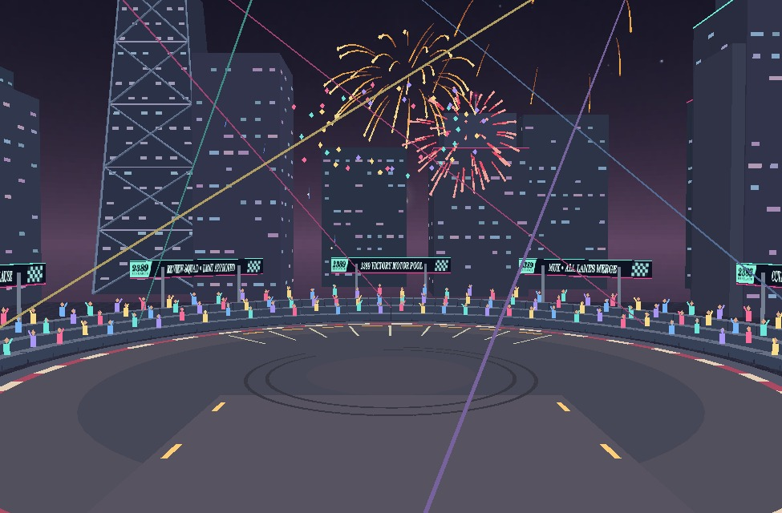

# Monster Truck Madness · Night Shift

**CAUTION: LOAD-BEARING SAND.**

The 2389 Research motor pool has seven monster trucks, one municipal lobster permit, and a pressing need to establish whether a satellite dish can survive a hard landing. You have been assigned the experimental vehicle. The other three drivers have been assigned the same experiment.

**[Play Night Shift](https://monster-truck-madness-96-racing.clintecker.chatgpt.site/)** · **[Driver handbook](docs/DRIVING.md)** · **[Build and contribute](CONTRIBUTING.md)**



## Get rolling

Open the game, pick an event, then hit **Enter**. Hold the throttle as **2** lights up and keep it down through green. Hold the **right mouse button** and drag to look at whatever just went past your window. Release to face forward again.

For offline play, use **Save offline** in the lobby or open the checked-in `dist/index.html` in your browser. The complete game travels in that one file, including the renderer, truck art, fonts, and sound synthesis.

## What's on the bill

| Classic Cup | After Hours Cup |
| --- | --- |
| **Blackout Mesa** — desert sprint, rallycross and a 3.40 km long course | **Packet Loss Pass** — 2.77 km of mountain relay, with eight jumps |
| **Feedback Loop** — a figure eight with crossing traffic and a 2.12 km long course | **Dead Letter Switchyard** — 2.65 km and fourteen gates through the dispatch district |
| **Overclock Strip** — a quarter-mile drag over two rows of cars | **Context Window 2389** — a 3.38 km lap with ten jumps and eighteen gates |

Take **Orrery Orbital** if the mission calls for an astronomical instrument on monster tires. **Mux Switchblade** carries the cable spool. **Soloclaw** brings the pincers. BIGFOOT, Grave Digger, Snake Bite and Carolina Crusher round out the garage. Tire, ride-height and final-drive choices save per truck.

The finish stripe stops the clock. The truck keeps going. Drive into the Victory Motor Pool while the drones assemble and the fireworks go up. The delay between flash and report depends on where you're standing.

## Under the hood

The editable game lives in `src/`. Python assembles it into one HTML page. Three.js renders the scene, a bundled WebAssembly rasterizer covers machines without WebGL, and a Canvas fallback uses painted sprites. Race timing and vehicle physics run on a fixed step.

```sh
python3 tools/build.py
python3 -m http.server 8000 --directory dist
```

Open `http://localhost:8000`. Building the HTML needs only Python 3.10 or later. Node powers the development tests and optional WebAssembly compiler.

- [Driver handbook](docs/DRIVING.md) — controls, transmissions, tournaments, Trackside and records.
- [Engine guide](docs/ENGINE.md) — the simulation clock, rendering paths, contact, fireworks and replay.
- [Content workshop](docs/CONTENT.md) — where to put a course, truck, sponsor or roadside act.
- [Contributor and release guide](CONTRIBUTING.md) — clean setup, test commands and reproducible handoff.
- [Credits and asset terms](docs/CREDITS.md) — engine, typefaces, sky maps and catalog data.
