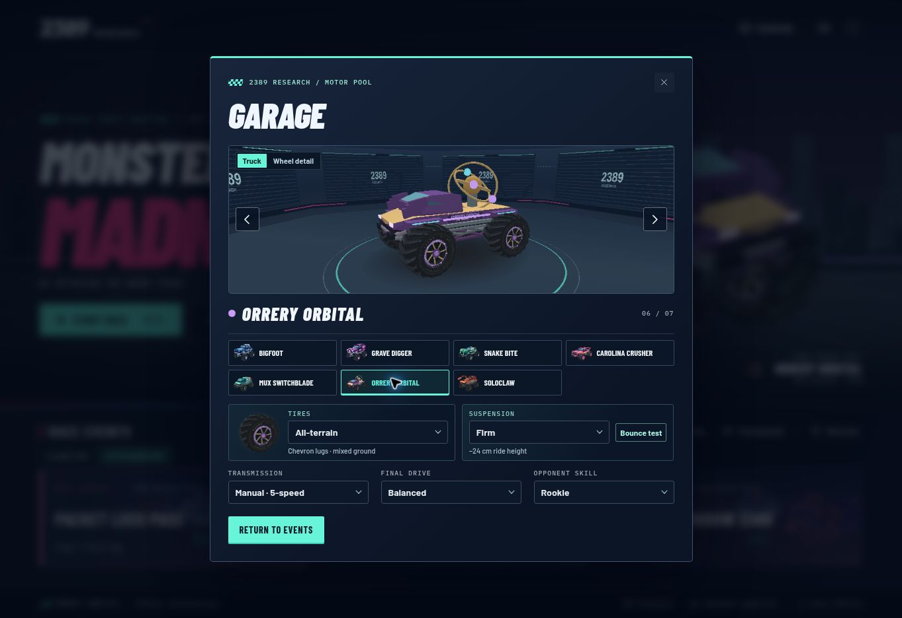

# Driver handbook

Pick **Classic cup** for the original desert, figure eight and drag events. **After hours cup** opens three longer circuits. A tournament uses the currently selected cup, carries your truck through three rounds, and awards 10, 6, 4 and 2 points by finishing place. The classic drag final combines two timed heats. A single race starts from the highlighted event card.

| Action | Keyboard or mouse | Gamepad |
| --- | --- | --- |
| Accelerate | W or up arrow | RT or A |
| Brake | S or down arrow | LT or X |
| Steer | A/D or left/right arrows | Left stick |
| Handbrake | Space | B |
| Shift down / up in manual | Q / E | D-pad down / up |
| Look around | Hold right mouse and drag. Release to center | |
| Cycle chase, cockpit and blimp | C | Y |
| Sound the horn | B | Press left stick |
| Recover to the course | R or H | LB |
| Pause | Esc or P | Menu |

**Launch.** During the countdown the grid holds the truck while its wheels spin. Get into first gear for a manual launch. Open the throttle on two for a boost. Holding full throttle too early can bog the start.

**Drive.** Pass the gates in order and in the indicated direction. The minimap shows your position and the next gate. Its elevation strip shows the height relative to the grid and the current grade. Amber chevrons mark a takeoff and mint stripes mark the landing area. The recovery control puts the truck back near the last safe position.

**Shift.** In automatic, holding the brake at a standstill engages reverse. In manual, use Q and E to move through reverse, neutral and five forward gears. Throttle powers the selected gear. A downshift that would over-rev the engine is blocked.

**Finish.** The timing beam records your finish before the victory rollout. You can drive, brake and park for 24 seconds. Press Enter or **Race results** to skip ahead. The result screen offers a replay. Records are stored in the current browser and keyed to the route and race distance.

**Sightsee.** From the lobby choose **Trackside** and select a category. Sponsor campaigns carry links to public projects. Honk at responsive attractions for their reaction. **Finish arena** runs the show without a race. Sound starts after a user gesture and follows the mute setting.
